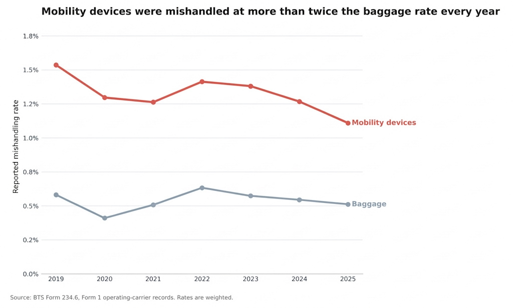
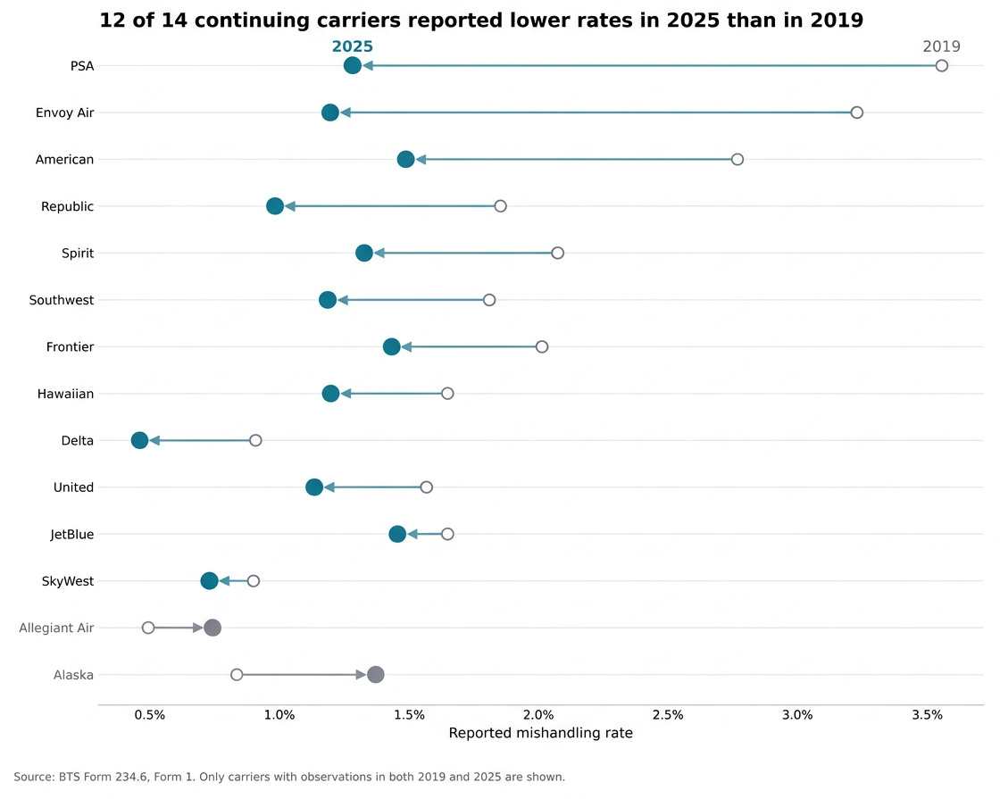

| [home page](https://cmustudent.github.io/tswd-portfolio-templates/) | [data viz examples](dataviz-examples) | [critique by design](critique-by-design) | [final project I](final-project-part-one) | [final project II](final-project-part-two) | [final project III](final-project-part-three) |

# Outline
## High-Level Summary

For most travelers, a mishandled suitcase is an inconvenience. For a passenger who relies on a wheelchair or scooter, however, a lost, delayed, damaged, or pilfered mobility device can mean losing the ability to move independently, work, or complete a trip as planned. This project will examine how frequently U.S. operating carriers report mishandling passengers’ wheelchairs and scooters, whether that risk has changed since federal reporting began, and whether improvement has been consistent across carriers.

Preliminary analysis of Bureau of Transportation Statistics data suggests that operating carriers reported nearly 63,000 mobility-device mishandling events between 2019 and 2025. Although the national weighted mishandling rate declined by approximately 28% over this period, mobility devices were still mishandled at more than twice the rate of checked baggage in every complete year examined. The project will present this as a story of real but incomplete progress: the national average has improved, but a substantial gap remains, and differences among carriers suggest that better outcomes are possible. A federal rule that took effect in January 2025 will appear as policy context, but the project will not claim that the rule caused the decline because the downward trend began earlier.

> **Note:** “Mishandling events” are reported incidents involving wheelchairs and scooters, not necessarily all unique devices or passengers.

## One-Sentence Summary

**Reported mobility-device mishandling has declined since 2019, but the rate remains more than twice that of checked baggage, and differences among carriers suggest that better performance is possible.**

## Intended Audience

The primary audience is the general traveling public, including passengers who travel with mobility devices and readers who may not previously have considered what happens when an airline mishandles a passenger’s wheelchair. A secondary audience includes policymakers, regulators, and airlines.

## Anticipated Story Flow

- **Human stakes:** Begin by explaining why a mishandled wheelchair has consequences far beyond those of a mishandled suitcase.
- **Persistent disparity:** Show that mobility devices have consistently been mishandled at a substantially higher rate than checked baggage.
- **Real but uneven progress:** Examine the national decline since 2019 and compare carriers to determine whether improvement has been broadly shared.
- **Resolution:** Conclude that better performance is possible, but greater transparency, consistency, and accountability are still needed.

## Call to Action

- **For policymakers and regulators:** Urge the U.S. Department of Transportation to require airlines and ticket sellers to display the operating carrier’s recent mobility-device mishandling rate during booking, allowing passengers to compare performance before entrusting a carrier with their wheelchair or scooter.
- **For passengers and the traveling public:** If a mobility device is lost, delayed, damaged, or pilfered, document the incident and report it to both the airline and the U.S. Department of Transportation. Those who witness an incident can offer to help the passenger document and report it, with the passenger’s permission.

## Initial sketches

### Sketch 1: Persistent Rate Gap

For most travelers, a mishandled suitcase is an inconvenience. For someone who depends on a wheelchair or scooter, mishandling can mean temporarily losing independent mobility. This visualization will compare the reported mishandling rates of mobility devices and checked baggage over time.

The two lines are intended to show that the disparity is persistent rather than the result of one unusual year. Direct labels at the end of each line will help identify the two categories without relying on a separate legend.

*Source: Bureau of Transportation Statistics, Form 234.6. Values shown in this sketch are preliminary and will be independently verified later.*

### Sketch 2: The Scale Behind the Rate

The previous comparison establishes the persistent rate gap. This chart translates those percentages into the number of mobility-device mishandling events reported each year.

Showing the count and rate together will help prevent changes in travel volume from being mistaken for changes in handling performance. The unusually low count in 2020, for example, largely reflects the sharp decline in the number of devices transported rather than a comparable improvement in the mishandling rate. Across the seven complete years, operating carriers reported 62,967 mishandling events.

*These figures represent reported events, not necessarily unique passengers or mobility devices. Source: Bureau of Transportation Statistics, Form 234.6, Form 1 operating-carrier records.*

### Sketch 3: When Did the Recent Decline Begin?

After establishing the scale of the problem, this visualization takes a closer look at when the recent improvement began.

The light-gray line shows the volatility of the monthly data, while the trailing 12-month rate makes the broader pattern easier to see. The January 2025 marker provides policy context, but it is not intended to suggest that the rule caused the decline. Instead, the chart shows that the most recent downward trend was already underway before the rule took effect.

*Source: Bureau of Transportation Statistics, Form 234.6, Form 1 operating-carrier records. Data for 2026 run through August.*

### Sketch 4: Was the Improvement Broadly Shared?

A national average can hide substantial differences among carriers. This comparison will examine the 14 operating carriers with observations in both 2019 and 2025.

The hollow circles represent 2019 rates, and the filled circles represent 2025 rates. Twelve of the fourteen continuing carriers moved toward lower reported mishandling rates, suggesting that the national improvement was broadly shared. Allegiant Air and Alaska moved in the opposite direction and remain visible as exceptions.

*Source: Bureau of Transportation Statistics, Form 234.6, Form 1 operating-carrier records. Only carriers with observations in both 2019 and 2025 are shown.*

### Sketch 5: Does Higher Volume Lead to Higher Rates?

The last chart will examine whether carriers that handle more mobility devices necessarily report higher mishandling rates.

Each point represents one operating carrier. The horizontal axis shows the number of mobility devices enplaned from 2023 through 2025 on a logarithmic scale, while the vertical axis shows the carrier’s weighted mishandling rate over the same period. The dashed line marks the overall weighted rate of 1.26%.

The wide variation among carriers with similar volumes suggests that handling more devices does not, by itself, explain a higher mishandling rate. This shows that poorer outcomes are not an unavoidable result of higher volume.

*Source: Bureau of Transportation Statistics, Form 234.6, Form 1. Includes operating carriers with complete monthly observations from January 2023 through December 2025.*

# The data

The primary dataset for this project is the Bureau of Transportation Statistics’ [Air Carrier Mishandled Baggage (Form 234.6) dataset](https://transtats.bts.gov/DL_SelectFields.aspx?QO_fu146_anzr=Zv5un0qyrq+Onttntr&gnoyr_VQ=GGD). It is publicly available through TranStats and can be downloaded without registration. The dataset contains monthly counts of enplaned and mishandled wheelchairs and scooters, along with comparable checked-baggage figures, organized by carrier and report type. The copy downloaded for this project includes mobility-device records from January 2019 through August 2026.

The analysis will primarily use complete calendar years from 2019 through 2025 to examine national trends, compare mobility-device and checked-baggage mishandling rates, and explore differences across carriers. Form 1 records, representing operating carriers, will be used for the core analysis; Form 2 codeshare records will be excluded to avoid combining operating- and marketing-carrier perspectives. Rates will be calculated by dividing total mishandled items by total enplaned items. Since the data are aggregated, the results represent reported mishandling events rather than unique passengers or devices.

## Data Access

- [Official BTS dataset and download page](https://transtats.bts.gov/DL_SelectFields.aspx?QO_fu146_anzr=Zv5un0qyrq+Onttntr&gnoyr_VQ=GGD)
- [BTS reporting documentation](https://www.bts.gov/topics/airlines-and-airports/number-30-%E2%80%93-technical-directive-mishandled-baggage-effective-jan-1-2019)

# Method and medium

I plan to build the final project in **Shorthand**, using **Tableau Public** to create and embed the visualizations. The story will unfold as scrolling, with short sections of text connecting the charts and guiding them through the main findings.

## References
Bureau of Transportation Statistics. (n.d.). *Air Carrier Mishandled Baggage (Form 234.6)* [Data set]. U.S. Department of Transportation. Retrieved November 16, 2026, from [https://transtats.bts.gov/DL_SelectFields.aspx?QO_fu146_anzr=Zv5un0qyrq+Onttntr&gnoyr_VQ=GGD](https://transtats.bts.gov/DL_SelectFields.aspx?QO_fu146_anzr=Zv5un0qyrq+Onttntr&gnoyr_VQ=GGD)

Bureau of Transportation Statistics. (2018, October 31). *Technical Reporting Directive #30: Mishandled baggage and wheelchairs and scooters*. U.S. Department of Transportation. [https://www.bts.gov/topics/airlines-and-airports/number-30-%E2%80%93-technical-directive-mishandled-baggage-effective-jan-1-2019](https://www.bts.gov/topics/airlines-and-airports/number-30-%E2%80%93-technical-directive-mishandled-baggage-effective-jan-1-2019)

U.S. Department of Transportation. (2024, December 17). *Ensuring safe accommodations for air travelers with disabilities using wheelchairs* (Final rule, 89 Fed. Reg. 102398). [https://www.transportation.gov/airconsumer/final-rule-ensuring-safe-accommodations-air-travelers-PDF](https://www.transportation.gov/airconsumer/final-rule-ensuring-safe-accommodations-air-travelers-PDF)

U.S. Department of Transportation, Office of Aviation Consumer Protection. (n.d.). *Air Travel Consumer Reports*. Retrieved November 18, 2026, from [https://www.transportation.gov/individuals/aviation-consumer-protection/air-travel-consumer-reports](https://www.transportation.gov/individuals/aviation-consumer-protection/air-travel-consumer-reports)

U.S. Government Accountability Office. (2022, November 17). *Passengers with disabilities: Barriers to accessible air travel remain* (GAO-23-106358). [https://www.gao.gov/products/gao-23-106358](https://www.gao.gov/products/gao-23-106358)

## AI acknowledgements

I used Google Gemini to brainstorm and narrow my project topic and to explore possible story structures and visualization approaches. I used these conversations as planning support, and the final written content, data analysis were completed by me.
